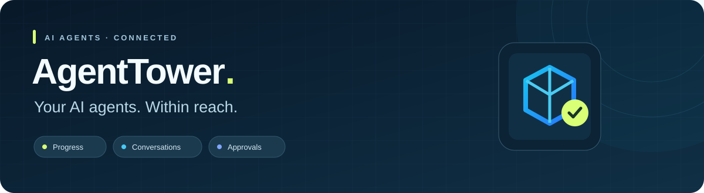

<p align="center">
  
</p>

<p align="center">
  <strong>你的 AI Agent 随身指挥台</strong><br />
  离开电脑，也能跟进任务、查看会话和确认受支持的操作。<br />
  <sub>Follow your AI coding agents from wherever you are.</sub>
</p>

<p align="center">
  <a href="https://github.com/agenttower-ai/agent-connector"><strong>开始使用 Connector →</strong></a>
  &nbsp; · &nbsp;
  <a href="https://github.com/agenttower-ai/agent-connector/releases">Connector 下载</a>
  &nbsp; · &nbsp;
  <a href="https://github.com/agenttower-ai/agent-tower-client/releases">Client 下载</a>
  &nbsp; · &nbsp;
  <a href="https://apps.apple.com/app/id6820363505">iOS App Store</a>
</p>

---

## 从 Agent Connector 开始

**[Agent Connector](https://github.com/agenttower-ai/agent-connector)** 运行在 AI Agent 所在的电脑上，将状态、会话和受支持的操作连接到你的控制客户端。使用 Go 构建，覆盖 Windows、macOS 和 Linux；编译后的连接器无需安装 Node.js。

适配 Claude Code、Codex、Cursor、OpenCode、CodeBuddy 和 DeepSeek Harness。各 Agent 的接入方式与能力不同，具体支持范围见 [适配器说明](https://github.com/agenttower-ai/agent-connector#支持的-agent)。

- **掌握进展**：离开工位后，继续了解长任务与会话状态。
- **处理确认**：在适配器支持时，查看并批准或拒绝操作请求。
- **连接多台电脑**：在同一个客户端查看已绑定设备和项目。
- **控制转发范围**：通过本机管理页管理授权与项目转发。

> 任务始终在原电脑执行，需要电脑、Agent 和 Connector 保持运行。

## 三个项目，一条连接

```text
电脑上的 AI Agent  ↔  Connector  ↔  Server  ↔  Client
```

| 项目 | 负责什么 | 技术与入口 |
| :--- | :--- | :--- |
| **[Agent Connector](https://github.com/agenttower-ai/agent-connector)** | Agent 接入、状态同步、会话与受支持操作 | Go · [文档](https://github.com/agenttower-ai/agent-connector#readme) · [下载](https://github.com/agenttower-ai/agent-connector/releases) |
| **[Agent Tower Client](https://github.com/agenttower-ai/agent-tower-client)** | 查看设备、任务与会话，处理受支持的审批 | Flutter · [文档](https://github.com/agenttower-ai/agent-tower-client#readme) · [下载](https://github.com/agenttower-ai/agent-tower-client/releases) |
| **[Agent Tower Server](https://github.com/agenttower-ai/agent-tower-server)** | 设备绑定、访问授权与消息中转 | Node.js · [自托管指南](https://github.com/agenttower-ai/agent-tower-server#readme) |

## 看看实际界面

| 连接电脑 | 跟进会话 | 处理审批 |
| :---: | :---: | :---: |
|  |  |  |

<sub>截图来自实际 Flutter 界面，使用虚构演示数据。可用操作由对应适配器决定。</sub>

## 自己部署，自己连接

1. 部署 [Server](https://github.com/agenttower-ai/agent-tower-server)，为远程访问配置 HTTPS/WSS。
2. 在运行 Agent 的电脑安装 [Connector](https://github.com/agenttower-ai/agent-connector)，指定你的 Server，并安装所需适配器。
3. 在 [Client](https://github.com/agenttower-ai/agent-tower-client) 中设置同一个 Server，通过一次性二维码或绑定码确认设备关系。

开源构建默认使用示例服务器地址，使用前需要改为自己的服务。中转可以读取转发内容，请使用可信的 Server。

## English

**AgentTower brings your AI coding agents within reach.** Check progress, follow conversations and handle supported approvals while you are away from your desk.

Start with **[Agent Connector](https://github.com/agenttower-ai/agent-connector)** on the computer running your agents. Connect it to a self-hosted **[Server](https://github.com/agenttower-ai/agent-tower-server)** and use the Flutter **[Client](https://github.com/agenttower-ai/agent-tower-client)** to follow along. The computer and agents continue doing the work; supported remote actions depend on each adapter.

[Connector documentation](https://github.com/agenttower-ai/agent-connector/blob/main/README.en.md) · [Client documentation](https://github.com/agenttower-ai/agent-tower-client/blob/main/README.en.md) · [Server documentation](https://github.com/agenttower-ai/agent-tower-server/blob/main/README.en.md)

## 一起改进 AgentTower

欢迎在对应仓库提交问题、适配器改进和 Pull Request。请使用虚构数据提供复现步骤，不要在公开 Issue 中上传设备凭证、真实会话或签名材料；安全问题请参考各仓库的 `SECURITY.md`。

三个项目采用 **MIT + 标识保留补充条款** 自定义许可，允许商用、修改和分发；须保留完整许可与已有的 AgentTower 来源标识。具体以各仓库 `LICENSE` 为准。第三方依赖与图标保留各自许可。
